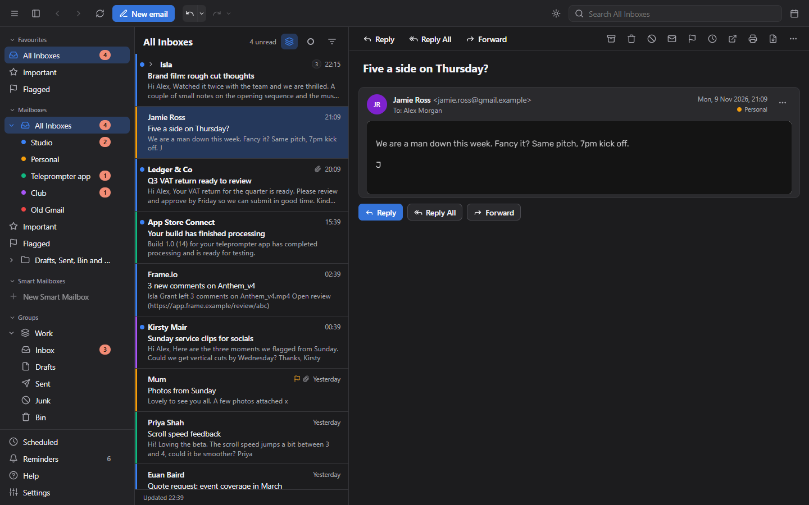
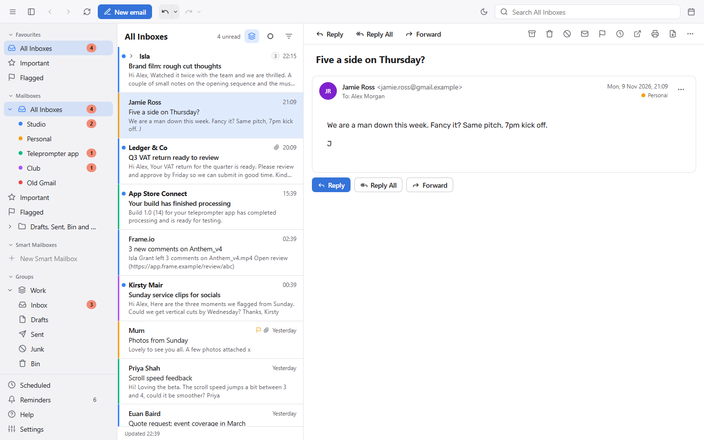
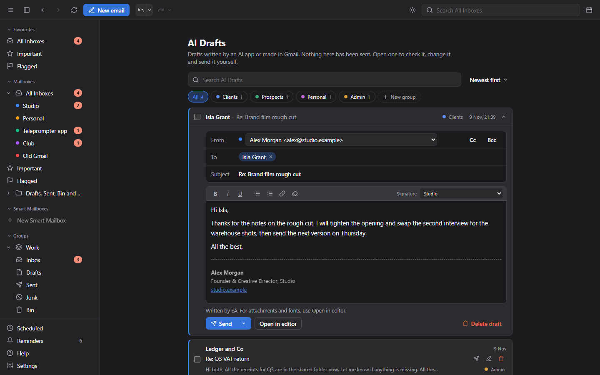
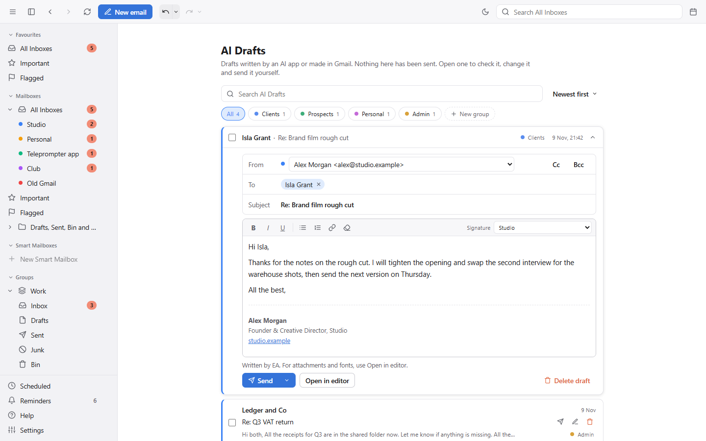
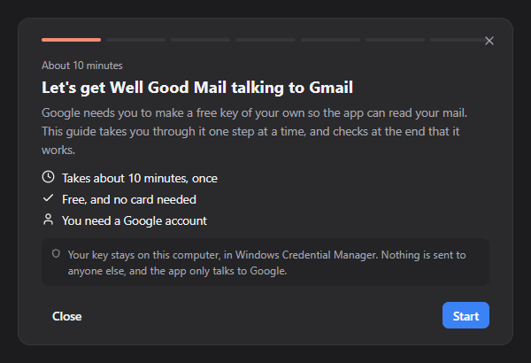

# Well Good Mail

An email app for Windows, inspired by Apple Mail: all your accounts in one combined inbox, with a clean three column layout and none of the clutter. It is not a copy of Apple Mail, just the same feel, for people on Windows. Gmail is set up and working today. Microsoft 365, iCloud, Yahoo and other IMAP mailboxes can be added too, and are less tested so far. It runs entirely on your own computer. There is no server of its own, and your mail only travels between your PC and your mail provider.

**Status: alpha.** It is a personal project that works for its maker and is shared in case it is useful to someone else. It comes as it is, with no support promised. Please keep your own backups of anything important.

## Screenshots

These use the built in demo mailbox, so there is no real mail in them.

## What it does

- Combined inboxes, custom groups, Smart Mailboxes (saved rules) and your own sidebar folders
- Three resizable columns; reply inline or pop any email or draft out into its own window
- Switch between Reply, Reply All and Forward without losing what you have written
- Undo send and undo for almost everything else, send later (even with the app closed), snooze, follow up reminders, templates, mute and one click unsubscribe
- Gmail aliases and signatures pulled in automatically, with a signature menu on every email
- An optional AI Connection: let Claude or another AI app on your computer search your mail and write drafts, only for the accounts and actions you allow. It never sends anything, and drafts wait under AI Drafts for you to check and send
- Images and trackers blocked until you allow them
- Offline reading and fast search across every account
- Out of Office for Gmail and Microsoft accounts, set inside each account, with dates, a message for each account and "While you were away"
- Attachments open straight away in their own app; dates in emails can go into your calendar with one click
- Light and dark mode, calendar reminders and meeting banners, attachment preview, an Accessibility page, and a Help page inside the app

## Install

1. Download the latest `Well.Good.Mail_x.y.z_x64-setup.exe` from the [Releases page](https://github.com/wellgoodtodd/well-good-mail/releases) and run it. Windows SmartScreen may say it does not recognise the app. Choose More info, then Run anyway.
2. The first time it opens, a short guide walks you through making your own free Google key (about 10 minutes) and checks that it works. This is needed because Google asks every app to identify itself, and this one has no shared key. Your key is stored in Windows Credential Manager on your own computer.
3. After that the app updates itself.

Until you publish your own Google project, Google signs you out about once a week. The guide, and Settings then Accounts, explain how to stop that.

## Moving to a new computer

Settings, then Search and storage, can export your downloaded mail to one file and import it on another computer, so nothing has to be downloaded again. The file holds your emails, so keep it somewhere private. Sign-in details are not in it.

## Building it yourself

See [SETUP.md](SETUP.md).

## Privacy

Your mail stays on your own computer. Well Good Mail talks only to your mail provider (Google, Microsoft, Apple or the mail server you set up) and to GitHub, to check for updates. The AI Connection is off until you switch it on, and then only AI apps on your own computer can connect, to the accounts you choose. It has no server of its own, collects nothing about you and has no tracking. Passwords and sign-in keys are kept in Windows Credential Manager. You can delete everything the app stores by uninstalling it and removing its folder in your user profile.

## Licence

MIT. See [LICENSE](LICENSE). The software is provided as it is, without warranty of any kind. The installer shows this licence and asks you to accept it.

## Notes

Apple and Apple Mail are trademarks of Apple Inc. Well Good Mail is an independent project. It is not made by, affiliated with or endorsed by Apple.
